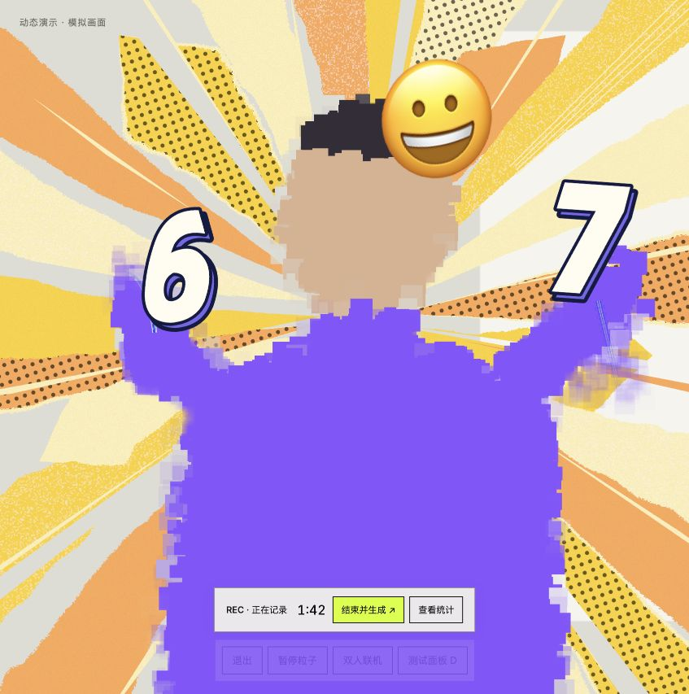

# Gesture repair verification — 2026-10-25

Base: main `4ca67c847324fb2c07200a62ce80b803f4a7028f` (R12.2).
All 93 tracked files in the starting snapshot matched GitHub Git blob hashes.
The four-language draft PR is separate and was not modified.

## Flow and findings

Camera observations flow through the MediaPipe worker, HandTrackFilter,
SixSevenGestureTracker and the WebGL numeral overlay. Rendering also needs a
complete foreground mask and camera projection.

R12.2 already retains the initial crossing through a brief single-hand miss,
accepts finite offscreen tips in the gesture tracker, clamps numerals into the
viewport, and separates gesture freshness from the shorter face display budget.
One measured vertical exchange activates; one visible hand retains its digit;
both hands missing for 1000 ms or two sustained fist samples stop the accessory.

Two remaining boundaries failed new regression tests before this patch:

1. A missing render projection disabled the gesture tracker, erasing both
   pending crossing evidence and an active latch. The overlay now continues
   measured tracking and normal expiry/owner checks while hiding the meshes.
   On projection recovery the same gesture resumes without another exchange.
2. The worker clipped every landmark to [0,1], distorting offscreen finger
   geometry before the fist cue and manufacturing palms at the camera edge.
   It now preserves finite coordinates, and omits hands whose measured palm
   is outside the image. The remaining hand continues through the existing
   partial-hand path. Fingertip ink already rejects offscreen tips independently.

Only two production files changed. No background, expression thresholds,
inference scheduling, particle effects, final artwork or room code changed.

## Existing background and cadence

The background retains 24 radial petals, 16 spears, three line bundles and eight
transparent seams. Its family transition is 1500 ms, with two-stage 200 ms
weight smoothing, 420 ms intensity smoothing and 550 ms origin smoothing.
Existing geometry/transition/buffer tests pass unchanged.

Camera capture requests 24 fps (max 30); tracking attempts are scheduled every
80 ms and skip while the sequential CPU worker is busy. Thus 12.5 attempts/s
is a scheduling ceiling, not an observed inference rate. The gesture panel's
sample interval is distinct from the renderer FPS.

## Evidence

- Three new regression tests failed before the changes and pass after them.
- All 300 tests outside `tests/prototype.test.mjs` pass, including the existing
  slow-CPU cadence, source freshness, person change, fist exit, missing-hand,
  numeral placement, radial layout and smooth-retargeting cases.
- The three server-listener tests hit sandbox `listen EPERM` in the baseline;
  they are not counted as passes. The test suite remains unchanged in package.json.
- `npm run build` passes and verifies all 13 pinned vendor assets.
- `git diff --check` passes.
- The repaired page was opened using a local static preview server in the
  in-app browser with real Three.js r180 / WebGL2. Demo mode visibly showed
  both numerals, radial camera cutouts, particles and emoji. Switching from
  neutral to smile retained the gesture and changed the palette. Captured
  browser error/warning logs were empty.
- Demo panel readings were approximately 113–120 render FPS at this viewport.
  Demo hands are generated each animation frame, so their sample frequency is
  not evidence of camera inference performance.

Physical camera recognition, real tracking FPS and edge-of-frame behavior with
real hands still require device testing. Synthetic landmark tests establish
state and coordinate handling, not detector accuracy when a hand is occluded.

