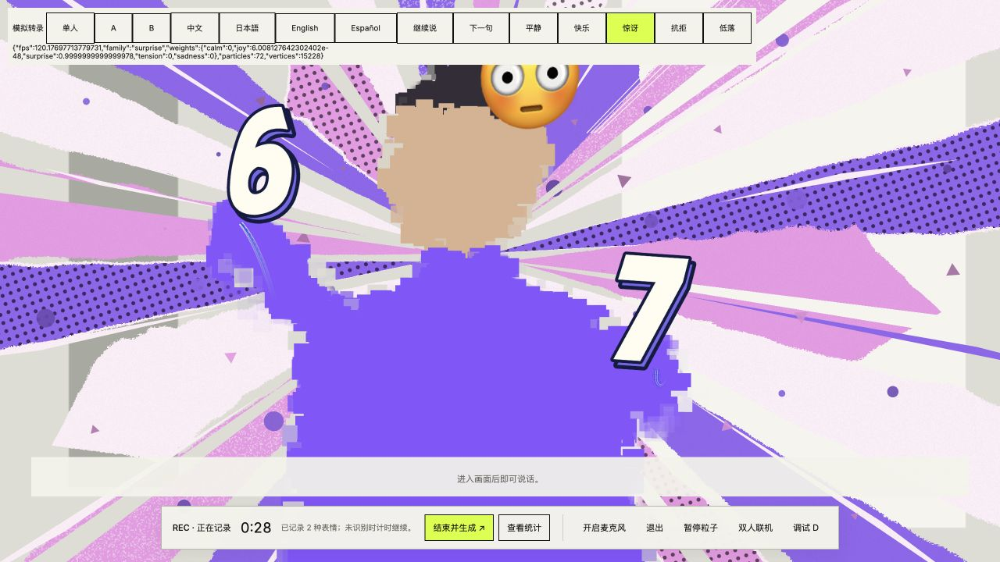

# Caption timing and decorative background retention

Completed local captions disappear 1300 ms after the transcription final event.
Translated peer captions use the same dwell after their final translation arrives.
Interim text stays visible; a new utterance cancels the previous deadline. Expiry
preserves turn/revision ordering, so delayed results cannot resurrect old captions.

Only the decorative backdrop holds joy, surprise and tension for 1600 ms after
the last matching observation when the source returns to calm. Existing smooth
transitions then continue. Another expressive family retargets immediately.
The classifier, emoji and session statistics do not inherit this hold. Ownership
changes and invalid tracking still clear the backdrop, and pause freezes its clock.

All five palettes now include 36 triangles and 36 circles. Their positions, scale,
rotation and brightness move continuously with the existing animation phase.
They share the current mesh, inks and camera-window discard mask. Total geometry
is 15,228 vertices within the existing 18,000-vertex buffer; no mesh or render pass
was added. Pause/reduced-motion behavior uses the existing decorative clock.

Validation: 418 tests passed (TCP listener tests excluded under the existing
sandbox restriction), and production build passed with 13 vendor assets verified.
New tests cover exact caption deadlines, stale callback cancellation, peer ordering,
hold expiry, expressive retargeting, pause, owner/eligibility resets, particle
animation and the fixed geometry budget. Browser checks use simulated transcripts
and expressions with the actual WebGL renderer; live tracking/ASR latency was not
remeasured in this change.

