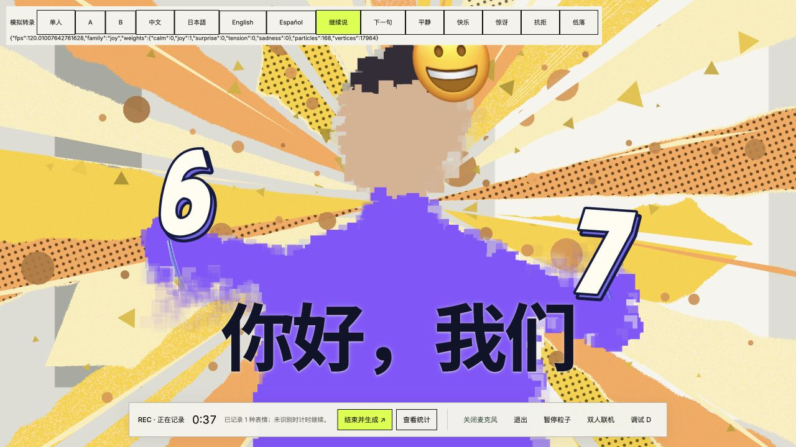

# Denser decorations and transparent captions

Each palette now has 168 decorations (84 triangles, 84 circles), up from 72.
Seven radial bands and three size ranges create denser coverage with occasional
larger shapes. Movement, palette blending and the existing hold times are retained.
The mesh uses 17,964 vertices within its existing 18,000-vertex buffer.

Caption backgrounds are transparent. The idle “请说话 · 中文” prompt is removed;
empty caption regions collapse. A subtle text-only shadow helps readability.
Connection/permission errors remain available without a rectangular caption panel.

Validation: 24 relevant backdrop/speech tests passed, production build passed,
and browser checks confirmed transparent captions, increased particle density,
and no idle prompt. The screenshot uses simulated transcripts and expressions.

