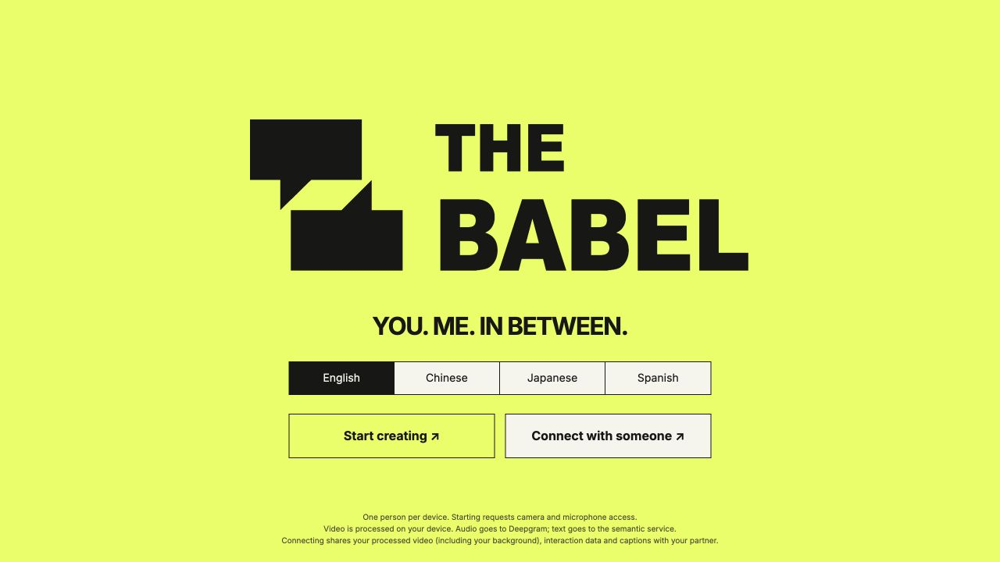
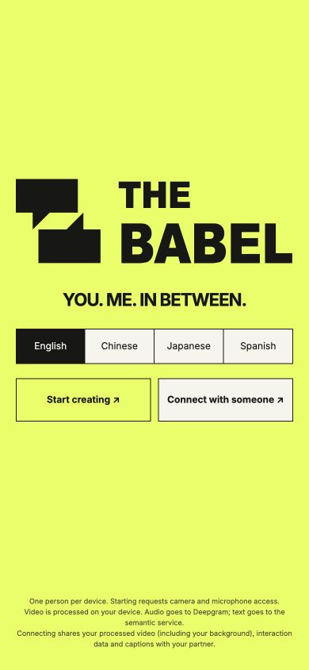

# Homepage redesign

Implemented from the supplied 1518 × 842 reference: fluorescent yellow-green background, centered black conversation mark and THE BABEL wordmark, English tagline, a segmented four-language selector and two entry buttons. The homepage demo button and its event binding are removed. Demo fixtures remain available for internal tests and the existing room connection diagnostic source.

`intro.css` scopes the new design to the welcome screen. `intro.js` forwards language selection to the existing speech controller, preserving recognition/translation language and saved preferences. Camera/microphone handling, live captions, artwork, gesture tracking and session results keep their existing behavior. Small consent text remains visible at the bottom.

Validation:

- 421 tests passed; the three existing TCP-listener tests remain excluded because this execution sandbox cannot bind their sockets.
- Production build passed; all 13 pinned assets verified.
- Browser checks at 1280 × 720, 390 × 844 and 320 × 640 verified responsive layout, language selection, persisted selection after reload, and opening/closing the room panel. The 320px layout stacks the two action buttons without overflowing.
- Existing entry tests confirm camera/speech startup and exit still work with no homepage demo element. The browser check did not record real microphone/camera input.

