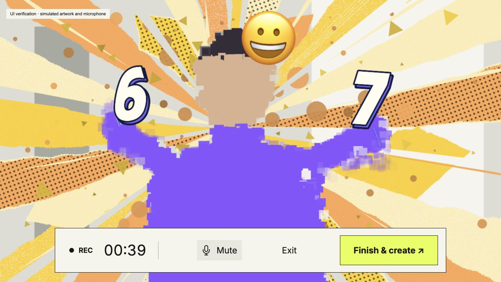

# Live toolbar redesign — 2026-10-25

Replaced the interaction toolbar with the supplied ivory, black-border design: REC and elapsed time, Mute/Unmute, Exit, and a yellow-green Finish & create button. Narrow screens use two rows.

Removed pause (including Space), the toolbar room entry, diagnostic button, manual statistics start, and separate view-statistics action. D still toggles diagnostics. Homepage networking and the results dialog remain available. Finish & create reopens the completed results when returning to the canvas.

Mute releases speech capture and clears captions without adding a status prompt. Artwork recording and its timer continue. Unmute restarts speech capture.

## Verification

- 423 automated tests passed; three prototype-server tests were blocked by the sandbox denying TCP listen (EPERM on 127.0.0.1).
- Production build passed with all 13 vendored assets verified; git diff whitespace check passed.
- Browser checks at 1280×720, 390×844, and 320×740 confirmed desktop/mobile layout and Mute/Unmute.
- Using the real renderer, speech UI, session controller, and results view with simulated inputs, verified that mute leaves recording running, Finish opens results, results can reopen, and a new round starts.
- No live microphone transcription or two-device network call was performed in this UI check. Existing speech, gesture, and network regression tests remain in the suite.

